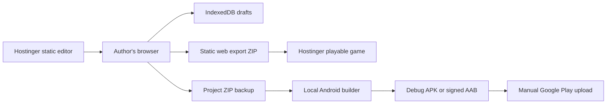

# Architecture and hosting decision

Update: see [confirmed product priorities](product-priorities.md) for screenshot-
verified hosting details, the Android-project ZIP deliverable and collaboration.

Status: original design, 22 October 2026, with the following superseding decision
on 26 October. Shared PHP/MariaDB storage is implemented and is a core requirement,
not optional. The authoring PC will not run Android Studio. A separate computer
downloads an Android project ZIP from the shared web app and builds/signs it.
Browser playtesting (including fullscreen and chapter/deck scenario controls) is
the next priority. See the updated implementation plan for current work; sections
below describing local-only storage or deferred sync are historical rationale.

## Product boundary

Create a project, choose a visual theme, author illustrated cards, configure
decks and chapters, playtest, save, and export playable web and Android games.
Story setting and visual theme are separate: choosing a theme does not generate
writing or artwork. AI generation is optional future functionality.

## Recommended architecture

| Component | Technology | Runs where |
| --- | --- | --- |
| Visual editor | React, TypeScript, Vite static build | Browser, served by Hostinger |
| Engine and validation | Shared TypeScript packages | Browser and local builder |
| Player | Shared HTML/CSS/TypeScript renderer | Browser or Android WebView |
| Project persistence, first version | IndexedDB, including image blobs; ZIP backups | Author's browser |
| Android preparation/build | Capacitor, Gradle, Android SDK; optional Node helpers | Separate Android-equipped build computer |
| Shared project storage | Authenticated PHP API, MariaDB, private assets | Hostinger; production verification pending |

The editor must not depend on Node.js at request time. Node is used to compile
the editor during development and to build Android packages locally.
The player does not contain editor features, secrets, or a dependency on the
factory. Share the same engine and player renderer with the embedded preview.

## What the current hosting can do

Hostinger documents Custom PHP/HTML hosting and static front-end hosting. Use a
static deployment, not a hosted development server. Example locations are
`factory.your-domain.example` for the editor and
`play.your-domain.example/harbor/` for a published game; names are placeholders.
Separate origins are preferable to prevent published content from sharing the
editor's browser storage. Verify subdomain/site allowances in hPanel first.

Current managed Node.js documentation lists Business/Unlimited and Cloud plans.
Do not assume Premium has a managed Node backend. Existing plan variants can
differ; inspect the actual account before deployment.

Shared hosting is not the planned Android compilation environment. Disk space
does not establish support for Java, Android SDK tooling, long-running jobs or
the necessary CPU/memory. A hosting upgrade solely to add Node would not prove
that Android builds are supported either.

## Meaning of hosting in version one

- The editor URL is reachable online; editing and simulation execute in-browser.
- Drafts are local to the browser profile and origin. Opening the editor on a
  second computer does NOT retrieve those drafts automatically.
- IndexedDB is not a backup. Offer explicit ZIP export/import, storage usage,
  quota-error handling, persistence requests where supported, and backup reminders.
- Browser-local drafts are not uploaded by default. Publicly hosting the editor
  code does not expose those drafts, but it does not make the editor itself private.
  If private access is desired, configure verified server-side access protection;
  an unlisted URL or a client-side password is not access control.
- Published web games are static and require no database or player accounts.
  Browser saves are local. Offline web installation is a later feature; bundled
  Android games must work offline from their first launch.
- First hosting uploads use hPanel/SFTP manually. Do not put hosting credentials
  in browser JavaScript. Automated deployment can be added separately.

## Android export UX and the intentional tradeoff

Baseline: click Export project in the hosted editor, open that ZIP in a local
builder, then click Build APK or Build AAB. The builder provides setup diagnostics,
progress, errors and an output folder. No terminal use during normal operation.
The first toolchain installation can require guided human setup and downloads.

This is a two-step handoff, not a claim of browser-only one-click compilation.
If one-button Android builds from the hosted editor are mandatory, add a separate
milestone for a secure local companion or authenticated remote build service.
Do not silently connect a public website to an unrestricted local command runner.
A companion needs explicit pairing, trusted-origin checks and fixed build actions.
Remote builds need authentication, queues, artifact expiry and signing-secret
handling. Neither is required to publish the first games.

## When to add server storage

If cross-device editing is required, prefer a small PHP API on the existing plan
over upgrading solely for a Node server. Confirm PHP/database versions and quotas
first. Store private drafts/assets outside public web paths, authenticate all
requests, use CSRF protection and revision checks, validate uploads, cap archive
sizes and reject path traversal. A backup and restore test is mandatory.
This adds another language and backend maintenance, so defer unless needed.

## Cost decisions

- Reuse the paid hosting; no additional hosting tier is assumed.
- No paid game engine, mandatory AI API, remote build service or live game backend.
- Local builds use existing hardware, disk space and electricity.
- Ongoing costs include domain/hosting renewal, optional assets, AI use if added,
  and maintenance of dependencies and Android compatibility.
- Existing editors such as GDevelop are cheaper for a first game if a general
  editor is acceptable. This project pays for a dedicated reusable authoring UX.
- Godot/Flutter remain alternatives if the Stage 1 phone prototype reveals a
  material WebView limitation. Do not rewrite merely for hypothetical advantages.

## Sources checked on 22 October 2026

- Hostinger website types: https://www.hostinger.com/support/1583214-how-to-add-a-website-in-hostinger/
- Hostinger managed Node: https://www.hostinger.com/support/how-to-deploy-a-nodejs-website-in-hostinger/
- Hostinger Node options: https://www.hostinger.com/support/node-js-hosting-options-at-hostinger/
- File upload location: https://support.hostinger.com/en/articles/4548688-basic-actions-in-the-file-manager
- Capacitor environment: https://capacitorjs.com/docs/getting-started/environment-setup

These sources establish platform options, not verified entitlements for this account.
